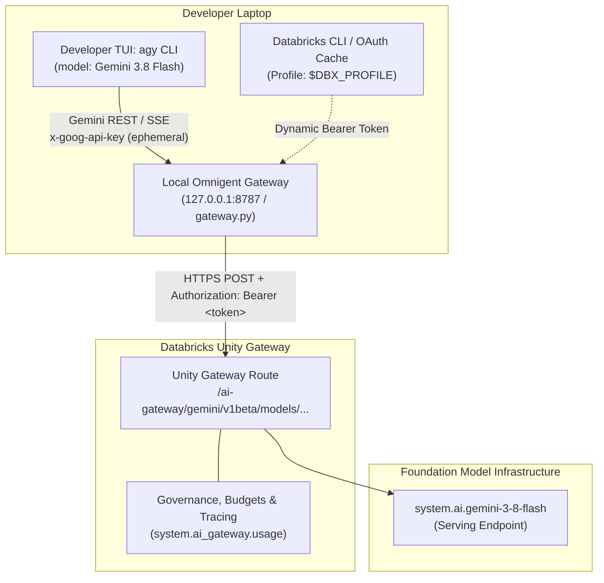
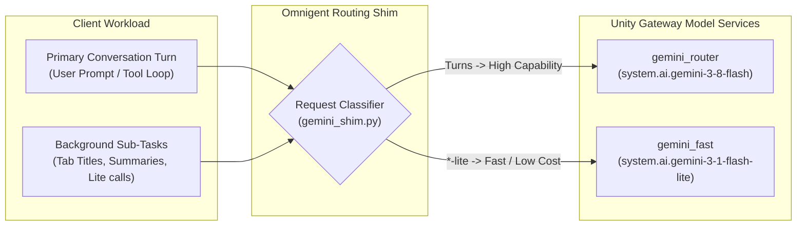

# Slide Content & Schematics: Antigravity & Omnigent Routing Architecture

This document provides presentation-ready content, talking points, and visual schematics for the talk and slide deck.

---

## Slide 1: The Meta-Harness Bridge (Client-to-Gateway)

### Slide Meta
* **Title:** Bridging Native Coding Agents into Unity Gateway
* **Subtitle:** How Omnigent turns Antigravity into an enterprise-governed client without modifying `agy`
* **Category:** Architecture / Developer Experience

### Key Takeaway
Native developer tools (like `agy` or `claude`) expect public provider keys and APIs. Omnigent acts as an ephemeral local gateway that translates protocols, injects enterprise OAuth Bearer tokens, and routes traffic through Unity Gateway with zero changes to developer muscle memory.

---

### Visual Schematic (Diagram for Slide)

---

### Bullet Points for Slide
* **Zero Binary Modification:** Runs the native Google Antigravity binary (`agy`) with isolated configuration (`--gemini_dir`).
* **Authentication Seam:** Translates Gemini API key format into short-lived Databricks OAuth Bearer tokens on the fly.
* **Central Governance:** Replaces untracked personal API keys with Unity Gateway rate limits, budgets, and enterprise audit logging (`system.ai_gateway.usage`).
* **Model Normalization:** Seamlessly resolves client-side model strings (`gemini-3.8-flash`) to Unity Catalog model services (`system.ai.gemini-3-8-flash`).

---

### Speaker Talk Track
> *"Native coding agents like Google Antigravity speak standard vendor APIs—in this case, Gemini REST and SSE with an API key. But in the enterprise, we don't want engineers hardcoding personal API keys or sending code to ungoverned endpoints.*
> 
> *Omnigent serves as a meta-harness. It wraps `agy` with an isolated local proxy. When `agy` issues a prompt, it connects to a localhost adapter. Omnigent injects a fresh Databricks OAuth token from the active Databricks CLI profile, maps the model name, and forwards the payload to Databricks Unity Gateway.*
> 
> *The developer gets the full native Antigravity experience and speed; the platform team gets full auditability, cost control, and centralized model routing."*

---

## Slide 2: Tiered Client-Side Routing (Performance & Cost)

### Slide Meta
* **Title:** Tiered Routing: Splitting Turns from Background Agent Work
* **Subtitle:** Intelligent cost optimization for multi-turn agentic workflows
* **Category:** Routing & Economics

### Key Takeaway
Agentic IDEs generate high background token traffic (summaries, titles, speculative work). Omnigent routes primary user turns to reasoning/high-capability models and background work to fast/light models automatically.

---

### Visual Schematic (Diagram for Slide)

---

### Bullet Points for Slide
* **Asymmetric Traffic Patterns:** Agent sessions generate continuous background requests (`*-lite`) alongside primary reasoning turns.
* **Client-Side Tiering:**
  * **Interactive Turns:** Directed to `gemini_router` (`system.ai.gemini-3-8-flash`).
  * **Background Tasks:** Directed to `gemini_fast` (`system.ai.gemini-3-1-flash-lite`).
* **Economic Impact:** Slashes token spend on metadata and context maintenance without degrading agent reasoning quality.
* **Verified Split:** Tested live in this environment with an 80/20 turn-to-lite traffic distribution.

---

### Speaker Talk Track
> *"Autonomous coding agents don't just call a model once per prompt. Behind the scenes, Antigravity fires off continuous background requests for titles, summaries, and sub-agent coordination using its `*-lite` models.*
> 
> *Our routing shim classifies these calls on the fly. Heavy interactive turns route through `gemini_router` powered by Gemini 3.8 Flash, while lightweight background operations route to `gemini_fast` on Gemini 3.1 Flash-Lite. You get peak interactive performance while optimizing token expenditure directly through Unity Gateway."*

---

## Presentation Checklist & Constraints
* **Product Naming:** Use **Unity Gateway** (CLI `ug`), not "Unity AI Gateway".
* **Model Versioning:** Demo model is **Gemini 3.8 Flash** (`system.ai.gemini-3-8-flash`). Gemini 4 Argon is mentioned only as a release note, never claimed as live on this demo workspace.
* **Privacy:** Never include literal workspace hostnames, catalog names, or tokens in slides or demo captures. Use `$DBX_PROFILE` and `<workspace-host>`.
