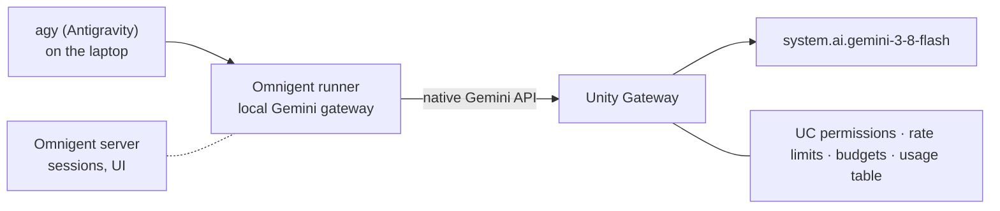

# N2: Antigravity + Gemini on Unity Gateway

Draft, 2026-11-03. Covers N2 (required) and N2b (optional Gemini 4 Argon line). Claims are cited by row label from `docs/research/facts.md`. Internal sources are repo paths.

Verification legend: **verified** = primary source or recorded probe. **verified (one run)** = observed once, re-check on the day. **UNVERIFIED** = do not put on a slide.

## Placement and timing

- **Slot:** after slide 11 (harness picker, 13+ harnesses, Plugin SDK). Slides 12 to 22 shift by one. N2b, if used, adds one more.
- **Why here:** slide 11 says you can pick a harness. This slide shows one harness actually running, and it's the one with a Google name. The cutaway proves the picker claim before slide 12 asks the room to trust a harness-agnostic YAML.
- **Air time:** slide about 12 s, cutaway 60 s, return bridge about 3 s. That's about 75 s, the top of the 60 to 75 s budget. This assumes the budget includes the cutaway. See Open threads.
- **N2b (Gemini 4 Argon):** default is one spoken line in N2's notes, not a sub-slide. Use the sub-slide only if the talk runs early. Never a demo.

## N2 slide

**Title:** Antigravity + Gemini on Unity Gateway

**On-slide text (22 words):**

> agy runs Gemini 3.8 Flash through Unity Gateway. Every call lands in the gateway usage table.
>
> Community-supported Omnigent harness · Omnigent on Databricks (Beta)

The labels are required. Antigravity is community-supported [facts: "Antigravity tier"], and the cutaway runs on managed Omnigent, which is Beta [facts: "Omnigent on Databricks"]. "Same usage table" rests on the account-wide usage rows [facts: "Usage table columns"; `docs/setup-log.md` §7]. The cross-cloud note is not on this slide. It's spoken at the start of the cutaway (below) and carried by the recap slide.

**Visual (one hop, left to right):**

Designer notes: the dotted server box is session state only, not in the model path. The chips around Unity Gateway name what the platform offers. They don't say these services are configured. See Gaps.

**Speaker notes**

- **Key line:** "Antigravity is still Antigravity. Its Gemini calls now go through Unity Gateway, so they land in the same usage table as everything else in this talk."
- **Beat (about 12 s):** "Antigravity is a community-supported harness in Omnigent. I'm running it on Gemini 3.8 Flash, which Databricks serves through Unity Gateway's native Gemini API. Here it is, already open."
  - Sources: [facts: "Antigravity tier"], [facts: "Gemini 3.8 Flash Databricks-hosted (Sep 2 2026)"], [facts: "Native Gemini API route on Unity Gateway"].
- **Why it matters to Google developers (about 8 s):** "Unity Gateway offers budgets and rate limits, and agy's calls get usage rows." (Reviewer fix: don't say "like any other model". Claude Code and Codex didn't land on this workspace, and Gemini-specific governance is UNVERIFIED.)
  - Budgets and rate limits: documented [facts: "Budgets / rate limits (Oct 15 2026)"]. Say "available", not "applied". No budget or rate limit is configured on the demo services (`demos/model-services/README.md`).
  - "Same permissions model": UNVERIFIED for Gemini. Cut it until a fact row exists.
- **Cross-cloud, one sentence, first thing in the cutaway:** "This runs on an AWS workspace. The Gemini docs I'm citing are GCP." Sources: [facts: "FEVM demo workspace"], [facts: "Gemini model names"]. The full cross-cloud slide is in the recap.
- **Argon line (N2b, optional, about 8 s):** "Gemini 4 Argon is also on Unity Gateway, as of the October 13 release notes. Same gateway." ("Same controls" has no facts row.) Source: [facts: "Gemini 4 Argon on Unity Gateway (Oct 13 2026)"]. Don't show it, don't say it runs here, and don't say it's on every cloud or region.
  - **HOLD:** the prep-reference point "switching to Argon is a model-name change, not a new integration" has no fact row and is UNVERIFIED. Use the line above instead, until a probe on an Argon-serving workspace shows the same route.
  - The cadence is real and can be said: three Gemini release-note rows in about two months, [facts: "Gemini 3.7 Flash on Unity Gateway (Aug 13 2026)"], [facts: "Gemini 3.8 Flash Databricks-hosted (Sep 2 2026)"], and Argon. That supports "new Gemini models arrive on the gateway as they ship."

## Demo beat: cutaway (60 s)

**Type:** pre-opened cutaway, not a live setup. The session is opened before the talk and switched to on stage.
**Tool:** `omni-fevm agy`, the presenter's home-manager wrapper. It lives outside this repo.
**Model:** Gemini 3.8 Flash, served as `system.ai.gemini-3-8-flash`.
**Verified path:** `docs/setup-log.md` §6 row 8 and §7. Don't use `omni agy --model` on this build, because it's dropped on the remote path (setup-log §6 row 7). Don't use `just agy-provider` on stage (unverified).

**Prerequisites (checked off stage):**

- Omnigent workspace preview enabled, and `omni-fevm host status` reports the host online (setup-log §1, §5).
- Run from a plain terminal, not from inside an agent session. A session shell leaks routing env into the host daemon (setup-log §8).
- agy 1.4.12 on PATH (plan Decision 9). Floor is 1.1.13 [facts: "agy install"].
- A neutral scratch directory as agy's workspace. [GAP: not created. Running from the repo would put the presenter's username on screen.]

**Pre-flight keystrokes (T-10 min, off stage):**

1. `omni-fevm host status`. Expect `mode=server  process=online  host=online`. If not, `omni-fevm host --background --no-open`.
2. `cd` to the scratch directory, then `omni-fevm agy`. The agy TUI opens.
3. In agy, type `/model`, arrow to **Gemini 3.8 Flash (Medium)**, press Enter. Expect `Model set to Gemini 3.8 Flash (Medium)`. The picker also lists Gemini 4 Argon, so do this step off stage only.
4. Type `Reply with exactly: fevm-agy-ok`, press Enter. Expect `fevm-agy-ok`. Same prompt and reply as setup-log §6 row 8.
5. Leave the session open. Clear the scrollback. Don't open the session's web URL.

**On-stage keystrokes (60 s timebox, from switch to slide return):**

1. Switch to the cutaway window, already in agy from pre-flight step 4. Full screen.
2. Say the disclosure: "Antigravity, on Gemini 3.8 Flash, through Unity Gateway. This is an AWS workspace."
3. Type `Reply with exactly: fevm-agy-ok`, press Enter.
4. Expect `fevm-agy-ok`. Say: "That call is now a row in the usage table. The next slide shows how the gateway picks a model."
5. Switch back to the slides.

**Switch-to-fallback rule (proposed; confirm in a dry run):**

- No output 15 s after Enter: switch to fallback.
- Reply not complete 40 s after Enter: switch to fallback.
- Any error text on screen (auth, 403, 404, 502): switch at once. Don't troubleshoot on stage.
- Fallback asset: `talk/fallbacks/antigravity-setup.mov`. [GAP: MISSING. The `talk/fallbacks/` directory doesn't exist. Record a redacted pre-flight run before the talk.] Until it exists, return to the slide and narrate `fevm-agy-ok` as the expected result. Don't show a terminal image that hasn't been screen-checked.

**Screen hygiene:**

- Neutral prompt in the cutaway shell. No username, no host.
- No browser. The session URL contains the workspace host.
- Don't scroll up in agy. The `/model` picker, with Argon, is in the scrollback.
- Don't run `omni-fevm config list` on stage. The Gemini provider label starts with `databricks-gemini-` (setup-log §4). [GAP: rename the label in the presenter's own config, outside this repo, or keep the listing off screen.]
- Don't run `databricks api get …/omnigent/v1/me` on stage. It prints a user ID. Pre-flight, off stage only.
- Don't echo `OMNIGENT_SERVER`. Don't show `~/.omnigent-fevm/config.yaml`.
- Redact the `requester` column (an email) in any usage row shown later.

**Rehearsal status:** no timed dry run yet. [GAP: run the cutaway three times against a timer, and log overruns. No `lessons.md` exists in the repo yet.]

## What we built for this

| Piece | What it does | Status |
| :--- | :--- | :--- |
| `omni-fevm agy` (the cutaway) | Omnigent's native agy adapter. Gemini 3.8 Flash on `system.ai.gemini-3-8-flash` | **verified**: setup-log §6 row 8, §7 usage row |
| `src/omnigent_talk/gemini_shim.py`, `just agy` | Localhost proxy. Adds Databricks auth and pins one custom model service. Bare agy: turns to `gemini_router`, `*-lite` calls to `gemini_fast` | **verified (one run)**, bare path only. `demos/model-services/README.md` go/no-go |
| `just probe` | One native Gemini call to `gemini_router` | **verified (one run)**: 200, served by `gemini-3.8-flash` |
| `resources/model_services.yml`: `gemini_router` (80% 3.8, 20% 3.7, fallback to 3.5 on 429/5xx), `gemini_fast`, `gemini_general`, `qwen_code` | Traffic split, ordered fallback, cheap tier | Deployed. **Model services are Beta in DABs** (file header). The file uses `databricks-gemini-*` paths. See Gaps |
| `just split-demo 20` | Tally of the model that served each call | **verified (one run)**: 16 by 3.8, 4 by 3.7. One 20-call sample, not a measured weight |
| Fallback to 3.5 | Configured in the yml | **UNVERIFIED**: never triggered (README open item 1) |
| Rate limits, budget | Not configured on these services. `just budget` not applied | **UNVERIFIED** on these services. Budget needs an account admin |
| `just agy-serve` + `just agy-provider`, then `omni agy` | Would route Omnigent's agy through the shim | **UNVERIFIED**: never run end to end. The `kind: key` provider shape is unverified too. Don't present as working |

**How they show up:** each call is a `system.ai_gateway.usage` row with `destination_model` and `routing_information.attempts[]` [facts: "Usage table columns"; `demos/model-services/README.md`]. The cutaway's row is `system.ai.gemini-3-8-flash` from the native adapter. The 80/20 split shows only on the bare `just agy` path, because only the shim targets `gemini_router`. Don't say the cutaway is 80/20. N3 carries the split.

## Links to the rest of the talk

- **Back to slide 7 (clients / server / host / runner):** in the cutaway, the runner on the laptop launches agy and runs the local Gemini gateway. Only that runner's calls go to Unity Gateway. The server holds the session (the session URL exists on the workspace server) and the UI. Evidence: `antigravity_testing.md` §2, `docs/setup-log.md` §6 and §8. [GAP: slide 7 isn't in this repo. Check that its "runner" means the same thing.]
- **Forward to N3 (routing):** "Gemini isn't one endpoint. Here's how traffic gets split." Tell N3 that the split is measured on the bare `just agy` path, not on the cutaway.
- **Forward to N4 (usage):** every call is a row in `system.ai_gateway.usage` [facts: "Usage table columns"]. The table lags about 20 minutes and is account-wide [`docs/setup-log.md` §7 lesson]. Show a row from an earlier run, filtered to the current user, with `requester` redacted. Never a live query on N2.
- [GAP: N3 and N4 titles and numbers aren't defined in the repo. These links assume routing and usage, as the brief says.]

## Facts to add

Same row format as `docs/research/facts.md`.

| Claim | Quote / detail | URL | Status |
|---|---|---|---|
| Antigravity traffic lands in the usage table | `system.ai_gateway.usage` row for `system.ai.gemini-3-8-flash`, client `python-httpx`, HTTP 200, 2026-11-03 06:35 UTC, from the `omni-fevm agy` run | `docs/setup-log.md` §7 | verified (one run) |
| Model is picked inside agy | `/model` → "Model set to Gemini 3.8 Flash (Medium)" | `docs/setup-log.md` §6 row 8 | verified (one run) |
| `omni agy --model` is dropped on the remote path | Runner log shows `model_override=None`. agy asks for its default `gemini-3.1-pro-preview`, which the adapter refuses. On 0.22.0.dev0 | `docs/setup-log.md` §6 row 7 | verified (dev build). Upstream issue OPEN. Say "on this build", not "bug" |
| Model calls leave from the runner, not the server | Host daemon's environment chose the gateway for claude-sdk. agy's gateway runs as a local process under the runner | `docs/setup-log.md` §8; `antigravity_testing.md` §2 | partly verified. Claim it for agy only |
| Two layers: server vs gateway | Server = sessions, UI, sharing, policies. Gateway = usage and traces, set by the harness's provider config | `docs/omni-fevm.md`, "Two layers" | verified by observation. **UNVERIFIED** until a primary Omnigent doc is linked |
| agy honors a custom Gemini base URL | Bare `just agy` answered through the shim, with `GOOGLE_GEMINI_BASE_URL` set | `demos/model-services/README.md`; `src/omnigent_talk/gemini_shim.py` | verified (one run) |
| Native Gemini streaming route | `:streamGenerateContent` on `/ai-gateway/gemini/v1beta/models/…`, used by Omnigent's adapter | `antigravity_testing.md` §2C | **UNVERIFIED**: only `generateContent` was probed |
| Custom service: traffic split and fallback | `gemini_router`: 80% 3.8, 20% 3.7; fallback to 3.5 on 429/5xx | `resources/model_services.yml`; `demos/model-services/README.md` | config verified. DBX docs URL OPEN: the README says "what the docs support" but records no URL |
| Split measured once | `just split-demo 20` → 16 by 3.8, 4 by 3.7 | `demos/model-services/README.md` | verified (one run). Not a weight measurement |
| Custom service probe | `just probe` → 200, served by `gemini-3.8-flash`. `gemini/v1/generateContent` in `supported_api_types` | `demos/model-services/README.md` | verified (one run) |
| Budgets are per user and workspace, not per service | "A budget can only be narrowed to a workspace, not to a service (services carry no tags)" | `demos/model-services/README.md`, Budgets | from our own notes. **UNVERIFIED** until read in the DBX docs |
| Argon is "a model-name change, not a new integration" | Release note: "…now available on Unity Gateway. You can access this model using Foundation Model APIs." It names no endpoint | DBX/gcp/en/release-notes/unity-gateway/ | **UNVERIFIED**. Needs a probe on an Argon-serving workspace |
| Gemini governance applies to Gemini specifically | Generic budget and rate-limit docs. No Gemini-specific row, and no UC permission row for model services | DBX/gcp/en/ai-gateway/rate-limits, /budgets | **UNVERIFIED** for Gemini |
| Antigravity is a Google product | Official installer at antigravity.google [facts: "agy install"] | DBX/gcp/en/ai-gateway/coding-agent-supported-agents is not the source; need a Google primary page | **UNVERIFIED** as "Google's" |
| On-stage build versions | agy 1.4.12 (local). Omnigent CLI 0.22.0.dev0 (git 08b7d804). Remote server 0.21.0.dev0. Latest release v0.20.0 | plan, Decision 9 and Research Status | verified (local). Say "dev build" |
| agy preselects the model in its settings | `antigravity_testing.md` §3 says the bridge writes `Gemini 3.8 Flash (Medium)`. Setup-log §6 row 7 says agy used its default | `antigravity_testing.md` §3 vs `docs/setup-log.md` §6 | **UNVERIFIED**, and the two sources conflict. Don't rely on it. Use `/model` |

## Gaps

1. **Fallback clip missing.** `talk/fallbacks/antigravity-setup.mov` and the `talk/fallbacks/` directory don't exist. The plan (Task 6, step 7) expects the clip. Record it from a redacted pre-flight run.
2. **Model paths in `resources/model_services.yml`.** Every Gemini destination uses `models/system.ai.databricks-gemini-*` (3.8, 3.7, 3.5, 3.1 Flash Lite), and `qwen_code` uses `databricks-qwen35-122b-a10b`. The prep-reference rule says never show `databricks-gemini-*`, and the served names in facts are `system.ai.gemini-*`. **Don't show this file as-is. Don't edit it here.** The fix is to rename to the `system.ai.gemini-*` names, then run `just gateway-validate`, `gateway-deploy` and `probe` again. Or keep the file off screen. That's the presenter's call.
3. **Gemini provider label.** It starts with `databricks-gemini-`, shows in `omni-fevm config list`, and appears in setup-log §4 and the replay script (step 3). Keep it off screen, or rename it in the presenter's own config.
4. **Referenced files that don't exist.** `demos/05-tracing/smoke.sh` (prep-reference day-of check) and `demos/02-antigravity/README.md` (plan Task 6) are not in the repo. Only `demos/model-services/` and `demos/routing/` exist.
5. **Argon in the `/model` picker.** Prep-reference says no Argon in a terminal. Mitigation: pick the model off stage, and never show the picker on stage.
6. **Argon "model-name change" claim.** UNVERIFIED (see Facts to add). N2 uses only the prep-reference "Say" line.
7. **`omni agy` through the shim.** UNVERIFIED end to end. The `kind: key` provider shape is unverified. `just agy-provider` tells the presenter to unset their current default gemini provider, which means changing their config. Don't present as working.
8. **Fallback, rate limits, budget on the demo services.** Not exercised, not applied (README open items 1 and 2).
9. **Conflicting model-selection evidence.** `antigravity_testing.md` Entry 1 and §3 conflict with `docs/setup-log.md` §6 row 7. Resolve before anyone quotes the test log.
10. **No timed dry run, and no tracking files.** `lessons.md`, `tasks.md`, `checkpoint.md`, `talk/outline.md`, `talk/runbook.md` don't exist in the repo. The rehearsal behavior expects outcomes in `lessons.md`.
11. **agy scratch directory** not created.
12. **`omni-fevm` is outside this repo** (presenter's home-manager nix config). The cutaway can't be rebuilt from the repo alone, so the runbook must name it.
13. **Deck text not in repo.** Slide 7's "runner" and slide 11's "13+" wording need checking against the deck. Facts say 18 harnesses in 3 tiers. "13+" is a floor, so it's consistent, but pick one number for the stage.
14. **Usage lag.** The usage table lags about 20 minutes (setup-log §7 lesson). N2 has no live usage.
15. **Timing assumption.** Whether the 60 to 75 s budget includes the cutaway (see Open threads).
16. **Stale narrative.** The plan's talk narrative (segment 5, 6 min, 60-min slot) predates the 20-minute brief. This section is sized for 20 minutes.
17. **UC permissions on model services.** Facts documents `EXECUTE` only for Smart Routing candidates. Nothing shows the same for these services.

## Open threads

- **Presenter decision:** does the 60 to 75 s include the cutaway? This draft assumes yes: 12 s slide, 60 s cutaway, 3 s bridge.
- **Presenter decision:** keep N2b (Argon sub-slide) or the one-line note? Default is the note.
- **Model paths:** rename `databricks-gemini-*` in `model_services.yml` before the dry run, or keep the file off screen.
- **Provider label:** rename it, or keep `omni-fevm config list` off stage.
- **Argon line:** probe Argon on a GCP profile (`DBX_GCP_PROFILE`, optional in plan) to earn the "model-name change" line. Otherwise leave it out.
- **Fallback clip:** record `talk/fallbacks/antigravity-setup.mov` from a redacted pre-flight run.
- **Shim path:** finish `omni agy` through the shim for N3, or drop it from the talk. It isn't presentable today.
- **80/20 on stage:** show the split on N3 using bare `just agy` and `just split-demo`, and label it as bare agy.
- **`/model` persistence:** confirm whether the pick persists for the cutaway session. The two repo docs disagree.
- **Claims review:** check the Argon and "Google product" rows against primary sources before the deck freeze.
