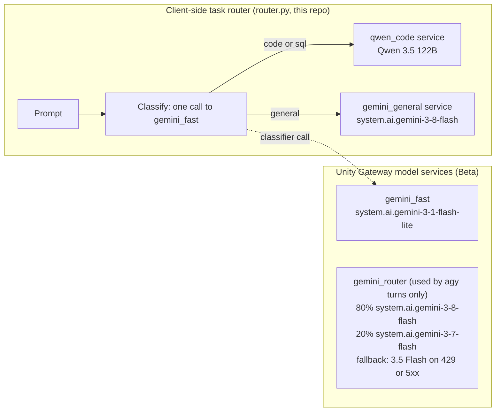

# Section 03: Routing and usage (N3, N4)

Two story slides for the "google dev - omnigent" talk, plus the demo beats that sit under them.
Slide numbers refer to the current 22-slide deck; they shift once these two slides are inserted.

| Slide | Placement | Slide time | Demo cutaway |
| :---- | :---- | :---- | :---- |
| N3 "Route the work, not the vendor" | After slide 14 (Two layers), before slide 15 (Share a session) | 60-75 s | 30 s, pre-captured `just ask` |
| N4 "One audit trail" | After slide 18 (Managed picture), before slide 19 (Live demo) | 60-75 s | 30 s, requester-filtered query output, plus a cropped dashboard still |

Budget risk: the story block is about 10 minutes, and these two slides plus cutaways add up to about 3 minutes. See Open threads.

---

## N3: Route the work, not the vendor

**Placement and timing:** after slide 14. Slide 14 says request-level governance sits underneath the trajectory, and routing is the first request-level decision this demo makes itself. 60-75 s, then a 30 s cutaway.

**Title:** Route the work, not the vendor

**On-slide text (25 words):**
> Client-side routing. Flash-Lite labels each prompt. Code and SQL go to Qwen; general goes to Gemini 3.8 Flash. Each call is tagged with its route.

Optional footnote, which takes the slide over 25 words if you add it: "Platform version, Beta: Unity Gateway Smart Routing, Claude Code and Codex only."

**Visual (corrected routing diagram):**



There is no link from the task router to `gemini_router`, because the task router never calls it. That matches the code. Splitting is random by weight per request, so `gemini_router` never reads the prompt. Every answer call carries `route=code|sql|general` as a request tag. [GAP: Qwen 3.5 122B has no facts.md row; see Facts to add.]

**Speaker notes**

- **Key line:** "A model service never reads the prompt. It splits at random by weight. So the decision has to happen before the gateway, in one cheap call, and the gateway just records what we decided."
- **How it works, for the presenter:** each prompt makes two calls. The first is a classify call to `gemini_fast`, Flash-Lite, with a 256-token budget (it thinks before answering). The second is the answer call to the route's service. Both carry request tags, so the usage table shows the decision next to the model that served it. If the label can't be parsed, or the classify call fails, keyword rules pick the route, and the tag says `classifier=keywords`.
- **Why it matters on Databricks:** Unity Gateway can split traffic and fall back on errors. It can't tell code from SQL from small talk. Routing by task is our code, but the decision lands in `system.ai_gateway.usage` with the same governance and the same columns as every other call. The platform team sees both the choice and the model that served it.
- **Platform version, one line:** "Unity Gateway also has Smart Routing, Beta. It picks models for Claude Code and Codex. What you just saw is different: our code, in this repo, routing the requests it makes itself." [facts.md: Smart Routing (Beta); Smart Routing details]
- **Token-budget beat (DHH):** "Cheap models for cheap work. At this moment in time, we are all token limited." David Heinemeier Hansson, Lex Fridman Podcast #501, about 01:02. [facts.md: DHH token-limited quote] Say the honest half too: the classifier is itself a call on every prompt, so it has to cost less than it saves.
- **Two layers link:** "Slide 14 said execution-level control on top, request-level governance underneath. Routing is the request layer making a decision for us, not just recording one."
- **Facts rows used (by label, in `docs/research/facts.md`):** Smart Routing (Beta); Smart Routing details; Usage table columns; Gemini model names; Gemini 3.8 Flash Databricks-hosted; Gemini 3.7 Flash on Unity Gateway; Budgets / rate limits (not configured here); Model services (Beta) and split/fallback rows [UNVERIFIED, to add]; Client-side task router [to add]; Classifier accuracy [to add]; DHH quote [to add].
- **Say:** "This is client-side routing. It isn't the platform's Smart Routing, which is Beta and covers Claude Code and Codex."
- **Don't say:** that the split is by task (it's random by weight); that fallback has been shown working (it hasn't been forced); that routing improves answer quality (no measurement exists).

**Demo beat (30 s cutaway, pre-captured by default)**

- **Exact recipe:** `just ask "Write a SQL query for the top 5 customers by total revenue from an orders table."` (line 5 of `demos/routing/prompts.txt`, one of the nine prompts that were classified correctly before deploy).
- **Expected output:** the first line is built by `cmd_ask` in `src/omnigent_talk/cli.py`, so the shape is fixed:
  `route=sql (by gemini_fast) -> qwen_code [qwen35-122b-a10b] <N> ms`
  The second line is the model's SQL answer. The exact text and latency haven't been captured, so the recording is the source of truth. [GAP: no captured `just ask` output in the repo.]
- **Screen note:** the CLI prints `qwen35-122b-a10b`, the configured name, not `system.ai.*`. Say "the terminal shows the configured model; the usage table shows the served one," or hide that line.
- **Timebox:** 30 s from the first frame of the recording to the answer's last line.
- **Fallback asset:** `talk/fallbacks/router-ask.mov` (screen recording) plus `talk/fallbacks/router-ask.txt` (text). Neither exists yet. [GAP: fallback assets not captured.]
- **Switch rule:** if no `route=` line appears 15 s after Enter, cut to the recording. Do not troubleshoot live; narrate the expected line.
- **Screen hygiene:** the terminal prompt and the working directory show the macOS username and the project path. Record from a clean prompt, or crop to the output. Don't show `DBX_PROFILE` or `.env.local`.
- **Live option (not the default):** `just router-demo` runs nine prompts and prints a tally of `code`, `sql` and `general` routes. Expected output by code: each route key shows 3 calls, 33.3%. Its per-prompt lines include latency. Too long and too uncertain for stage, so pre-capture it. [GAP: no recorded run of `router-demo` or `ask` against the qwen route since deploy.]

**Corrected on-slide wording for the existing slide 2 bullets (used in N3):**
- Replace "Tested live in this environment with an 80/20 turn-to-lite traffic distribution" with "One run of 20 calls: 16 served by Gemini 3.8 Flash, 4 by 3.7 Flash."

---

## N4: One audit trail

**Placement and timing:** after slide 18, the managed picture, and before slide 19, the live demo. Slide 19 runs on a different workspace from the FEVM demos, so say so on the way in. 60-75 s, then a 30 s cutaway.

**Title:** One audit trail

**On-slide text (22 words):**
> Calls through Unity Gateway land in system.ai_gateway.usage: requester, model served, tokens, routing, fallbacks. Queryable in SQL. Request-level governance under Omnigent's run-level control.

**Visual:** a cropped, pre-captured result table from the requester-filtered query (five rows, columns: service, destination model, route, attempts, tokens). No requester column, no endpoint name with the catalog in it. Alternatively, a cropped still of the routing dashboard's four counters and the by-route bar.

**Speaker notes**

- **Key line:** "Omnigent tells you what the run did. The gateway tells you what every request did, and you can ask it in SQL."
- **Be honest about coverage:** "On this demo workspace, native agy calls land here as Gemini 3.8 Flash. Direct pi calls land in a different table, the serving endpoint usage table. Claude Code and Codex calls didn't show up on this workspace. The likely cause is the laptop's org-managed settings, which send them to the org gateway. I haven't confirmed that, but it's device-level governance either way." [facts.md: Claude Code org-managed settings pin the gateway; plan lesson 2026-11-03 "Logs show intent; usage rows show truth."]
- **Why it matters on Databricks:** the table is a system table in Unity Catalog, so it's governed like the rest of the platform. Reading it needs account and metastore admin by default (the comment in `usage.sql`). That's the point: the request-level record is locked down, and it sits underneath the run-level view. The built-in usage dashboard has tabs for Overview, Spend, Coding Agents, MCPs, Skills and Performance. [facts.md: Usage dashboard tabs]
- **What it isn't:** it has tokens, latency, and routing, but no cost column. Don't say "dollars per row." Cost attribution is a dashboard feature; its details are not yet sourced. [GAP: how the Spend tab computes cost is unverified.]
- **Two layers link:** "Slide 14 said request-level governance underneath. This is that layer, as a table you can query. The spend caps and the UC permissions act on the same calls." [Spend caps are budgets: facts.md Budgets / rate limits row]
- **Facts rows used:** Usage table columns; Usage table coding-agent metadata (Sep 27 2026); Usage dashboard tabs; Usage tracking on by default (Jul 17 2026); Claude Code org-managed settings pin the gateway; Unified trace table (Beta) only if mentioned, and it is not used here [note: FEVM has no unified trace table yet]. Plus repo-observed rows to add (see Facts to add).
- **Say:** "Calls through the gateway, one table, SQL."
- **Don't say:** that every harness lands in this table; that usage rows arrive in real time; that the table records cost.

**Demo beat (30 s cutaway, pre-captured)**

- **Exact recipe:** the on-stage query must filter on the presenter. Nothing in the repo does that yet. The existing `demos/routing/usage.sql` and `demos/routing/metrics.sql` filter only by endpoint and time, and `just usage-sql` defaults to `%`, which is account-wide. Use this query, to be saved as a new file, not yet created:

  ```sql
  -- Calls made by the presenter, last 24 hours. Don't SELECT requester on screen.
  SELECT
    event_time,
    substring_index(endpoint_name, '.', -1) AS service,
    destination_model,
    coalesce(request_tags['route'], '-') AS route,
    size(routing_information.attempts) AS attempts,
    status_code,
    total_tokens
  FROM system.ai_gateway.usage
  WHERE requester = current_user()
    AND event_time > now() - INTERVAL 24 HOURS
  ORDER BY event_time DESC
  LIMIT 10;
  ```

  Run it with `databricks experimental aitools tools query <file> --profile "$DBX_PROFILE"`, the same form the justfile uses.
- **Expected output:** the shape only. Rows for the services `gemini_router`, `gemini_general`, `gemini_fast` and `qwen_code`, with route values `code`, `sql`, `general` or `-`. [GAP: exact `destination_model` strings and whether `qwen_code` rows exist in the table are unverified. The dashboard's "Served by Qwen" KPI assumes `destination_model LIKE '%qwen%'`, but no captured row confirms it.]
- **Timebox:** 30 s on screen. Pre-capture at least one hour ahead, because usage rows lag (see Gaps).
- **Fallback asset:** `talk/fallbacks/usage-query.txt` (captured output of the query above) and `talk/fallbacks/routing-dashboard.png` (cropped, no URL bar). Neither exists yet. [GAP: fallback assets not captured.]
- **Switch rule:** if the query hasn't returned in 10 s, or it returns nothing, cut to the captured table and narrate the rows. Don't debug on stage.
- **Dashboard:** `just dashboard-url` prints the workspace URL. Never show it, and never open the URL on the recorded screen. The dashboard's recent-calls table shows every caller of the `omnigent_talk` services in the account, not just the presenter, so use the pre-captured crop only. [GAP: no requester filter on the dashboard.]
- **Never on screen:** `just usage-sql` with its default `%` pattern (account-wide rows from other users), `just budget` output (it prints account and workspace IDs and the principal ID), `just dashboard-url` output, and the catalog-qualified `endpoint_name`.

---

## Corrections to routing-architecture-slide.md

Apply these to `talk/routing-architecture-slide.md` (not changed in this section). Each one is checked against the source.

1. **"Tested live … with an 80/20 turn-to-lite traffic distribution."** Wrong. The measured 80/20 is 16 of 20 calls served by 3.8 Flash and 4 by 3.7 Flash, from one `just split-demo 20` run. It's a split between two Flash versions inside `gemini_router`, not a split between turns and lite calls. Replace with: "One run of 20 calls: 16 by Gemini 3.8 Flash, 4 by 3.7 Flash." Evidence: `demos/model-services/README.md` line 60; `src/omnigent_talk/routing.py` `tally()`; `resources/model_services.yml` lines 11-27.

2. **`gemini_router` = `system.ai.gemini-3-8-flash` (single model).** Wrong. It's an 80/20 split: 80% Gemini 3.8 Flash, 20% Gemini 3.7 Flash, with an ordered fallback to Gemini 3.5 Flash on 429 or 5xx. The fallback is configured but has not been forced or observed. Replace the node with the split. Evidence: `resources/model_services.yml` lines 11-33; `demos/model-services/README.md` line 42 and open item 1.

3. **"Request Classifier (gemini_shim.py)."** Wrong. `gemini_shim.py` does a substring check, `"lite" in requested` in `target()`, and nothing else. The classifier is `router.classify()` in `src/omnigent_talk/router.py`, which calls `gemini_fast` through the chat API. The agy path never calls `router.py`. Replace the label with "lite-name check (gemini_shim.py)". Evidence: `src/omnigent_talk/gemini_shim.py` `GeminiShim.target`; `src/omnigent_talk/router.py` `classify`.

4. **"Local Omnigent Gateway (127.0.0.1:8787 / gateway.py)."** Wrong on both counts. The string `8787` appears nowhere in the code (only in this slide draft). `gateway.py` is an httpx client (`GeminiGateway.generate`, `.chat`), not a proxy. The localhost proxy is `gemini_shim.py`, and its port comes from `SHIM_PORT` in `serve` mode or a free port picked at random in `wrap` mode (`just agy`). Replace with "Localhost shim (gemini_shim.py), port from SHIM_PORT." Also note: `.env.example` doesn't list `SHIM_PORT` or `SHIM_KEY`, which `just agy-serve` and `just agy-provider` need. [GAP]

5. **"Model normalization (`gemini-3.8-flash` → `system.ai.gemini-3-8-flash`)."** This is Omnigent's behavior, not this repo's. Omnigent's agy adapter only discovers `system.ai.gemini-*` services (`omnigent/models/databricks_model_discovery.py`, cited in the README). This repo's shim doesn't map names: it forwards every request to the one service it's pinned to. Drop the bullet, or attribute it to Omnigent. Also drop "maps the model name" from the talk track.

6. **Rate limits in the governance list.** Not configured. No `rate_limits` block exists in `resources/`, and `demos/model-services/README.md` says so. Without a limit there are no 429s, so `just ratelimit-demo` has nothing to show as shipped. I did not run it. The platform does support rate limits (facts.md, Budgets / rate limits), so the slide can say the platform supports them and this demo doesn't configure one yet, or drop the bullet.

7. **"Without degrading reasoning quality."** Delete it. No source or measurement exists. The only measurement is the classifier labelling 9 of 9 demo prompts correctly before deploy. That measures routing labels, not answer quality.

8. **"Economic Impact: slashes token spend … without degrading agent reasoning quality"** (slide 2). The spend claim is unmeasured, and the usage table has tokens, not cost. Replace with what was measured: a 16/4 split and a classifier that labelled 9 of 9 prompts correctly.

9. **Slide 2, "Asymmetric traffic" and "Background tasks → gemini_fast."** The `*-lite` split was observed once, in the go/no-go run (`just agy -p "Reply with exactly: pong"`: turn on `gemini_router`, lite call on `gemini_fast`). Say "observed once" or leave it out of the bullet list. Also: the split is by requested model name, not by task. Any model name containing "lite" goes to `gemini_fast`; everything else goes to `gemini_router`.

10. **Slide 1 attributes the shim to Omnigent** ("Omnigent acts as an ephemeral local gateway", "Omnigent injects a fresh Databricks OAuth token", "maps the model name"). In this demo the shim does the auth and forwarding, and bare `just agy` runs with no Omnigent involved. Omnigent's own agy adapter is a separate path. Fix the attribution, or label which path the slide describes.

---

## Facts to add

Rows in `docs/research/facts.md` format. Where no primary source exists, the status is `[UNVERIFIED]`.

| Claim | Quote / detail | URL | Status |
|---|---|---|---|
| Model services (Beta) | Unity Gateway model services are a Beta DABs resource (`model_services`). Used here for `gemini_router`, `gemini_fast`, `gemini_general`, `qwen_code` | repo: `resources/model_services.yml` header; DBX URL [GAP] | [UNVERIFIED] primary doc URL missing |
| Traffic split mechanics | Up to 5 destinations, percentages sum to 100. Each request picks a destination at random by weight. A session header pins one session to one destination | repo: `demos/model-services/README.md` ("What the docs support") | [UNVERIFIED] claim cites docs but no URL is recorded |
| Fallback mechanics | Destinations are tried in order on 429 or 5xx only. Fallbacks have no traffic split. Retries appear in `routing_information.attempts` | same | [UNVERIFIED] as above. Forced failure not yet demonstrated |
| `gemini_router` split, measured | `just split-demo 20`: 16 served by 3.8 Flash, 4 by 3.7 Flash | repo: `demos/model-services/README.md` (go/no-go, 2026-11-03) | measured, n=20, one run |
| Gemini 3.5 Flash fallback in config | `gemini_router` falls back to 3.5 Flash on 429 or 5xx | repo: `resources/model_services.yml` | verified from config; behavior not observed |
| Client-side task router | `router.py` makes one `gemini_fast` classify call (max_tokens 256). code and sql route to `qwen_code`; general to `gemini_general`. Keyword rules pick the route when the label is unusable or the call fails. Answer calls are tagged `route` and `classifier` | repo: `src/omnigent_talk/router.py` | verified from source. Client-side, not a platform feature; distinct from Smart Routing (Beta) |
| Classifier accuracy | 9 of 9 demo prompts labelled correctly against `system.ai.gemini-3-1-flash-lite`, before deploy | repo: README open item 5 (2026-11-03) | measured, n=9, pre-deploy; classifier only |
| Qwen service | `qwen_code` routes to Qwen 3.5 122B, pay-per-token, served by the unified chat API only (not native Gemini) | repo: `resources/model_services.yml`; `src/omnigent_talk/gateway.py` docstring | [UNVERIFIED] no primary source; end-to-end route not recorded |
| Usage lag | About 20 minutes observed once: newest row 22 min old on 2026-11-03. Repo comments say "up to an hour" and "within about an hour" | repo: `demos/routing/usage.sql`, `demos/routing/metrics.sql`, README; plan lesson 2026-11-03 | [UNVERIFIED] conflicting. Needs a primary doc row before a figure goes on stage |
| Usage table is account-wide | Table held other users' traffic on 2026-11-03. Filter with `requester = current_user()` | plan lesson 2026-11-03; `docs/omni-fevm.md` | observed |
| Direct pi lands in a different table | pi calls appear in `system.serving.endpoint_usage`, not `system.ai_gateway.usage` | `docs/omni-fevm.md`, round 1 and final matrix | observed 2026-11-03 |
| Native agy lands in usage | Native agy calls appear as `system.ai.gemini-3-8-flash` in `system.ai_gateway.usage` | `docs/omni-fevm.md`, final matrix | observed 2026-11-03 |
| Claude and Codex calls didn't land | claude-sdk and native claude: no FEVM usage row in three rounds. codex: stays on org gateway. Likely cause: org-managed settings | `docs/omni-fevm.md` | observed; cause unconfirmed |
| Omnigent agy discovery | Omnigent's agy adapter only discovers `system.ai.gemini-*` services | repo README, citing `omnigent/models/databricks_model_discovery.py` | verified from source (Omnigent package), not docs |
| No rate limit configured | No `rate_limits` block in `resources/`; `just ratelimit-demo` has nothing to demonstrate | repo: `resources/`, `justfile` | verified from repo, 2026-11-03 |
| Routing dashboard | Four counters (calls, served by Qwen, avg latency, fallbacks), two bars, per-minute line, recent calls. 7-day window, filtered to the demo schema, not to the requester | repo: `dashboards/routing.lvdash.json`, `resources/dashboard.yml` | verified from file |
| DHH token-limited quote | "at this moment in time, we are all token limited." David Heinemeier Hansson, Lex Fridman Podcast #501, about 01:02 | [GAP: URL not recorded] | verified per brief; transcript not re-fetched in this pass |
| Bundle destination names | `resources/model_services.yml` names destinations `models/system.ai.databricks-gemini-*`. facts.md and prep-reference say `databricks-gemini-*` endpoints return 403 | repo | CONFLICT. See Gaps |

---

## Gaps

- `[GAP: no requester-filtered usage query exists.]` `demos/routing/usage.sql`, `demos/routing/metrics.sql`, the dashboard datasets, and the `docs/omni-fevm.md` query all filter by endpoint and time only. The N4 query above must be saved and run before stage. Don't SELECT `requester` on screen, since it's the presenter's email.
- `[GAP: usage lag conflict.]` The brief and the plan say about 20 minutes (one observation). The repo's README and SQL comments say up to an hour. No primary source row exists. Pre-capture at least an hour ahead, and avoid stating a number on stage until a source is recorded.
- `[GAP: no end-to-end route run recorded.]` Only the classifier was tested before deploy. `just ask` and `just router-demo` through `qwen_code` have no recorded output. The Qwen route is unverified.
- `[GAP: forced fallback not demonstrated.]` The README's open item 1 is still open, so N3 can describe fallback as configuration only.
- `[GAP: no rate limit configured.]` `just ratelimit-demo` has nothing to show as shipped.
- `[GAP: bundle model paths.]` `resources/model_services.yml` uses `models/system.ai.databricks-gemini-*`. The facts say `databricks-gemini-*` endpoints return 403. The go/no-go passed after `just gateway-deploy`, so the bundle path probably resolves. Confirm with `just gateway-show` (not run here). The slides use `system.ai.gemini-*` in every case, and the YAML must not appear on screen.
- `[GAP: Qwen facts.]` No facts row, no UC name checked, and the "chat API only" claim is unsourced.
- `[GAP: model services doc URL.]` The split and fallback mechanics come from the README, which cites docs without a URL.
- `[GAP: fallback assets missing.]` `talk/fallbacks/` doesn't exist in this worktree. Needed: `router-ask.mov`, `router-ask.txt`, `usage-query.txt`, `routing-dashboard.png`, all redacted.
- `[GAP: no latency figures.]` Nothing measured for `ask` latency through `qwen_code` or `gemini_general`. The timebox is a guess until the dry run measures it.
- `[GAP: dashboard not requester-filtered.]` The recent-calls table shows other callers. Use only a pre-captured crop.
- `[GAP: cost.]` The usage table has no cost column. How the built-in Spend tab attributes cost is unverified, so the "cost attribution" wording on slide 14 is not yet sourced for this demo.
- `[GAP: coding_agent metadata.]` Whether agy rows populate `session_metadata.coding_agent` isn't shown in any captured row. N4 claims "across harnesses" only with that evidence.
- `[GAP: workspace change at slide 19.]` The N4 query runs on the FEVM demo workspace. The live demo at slide 19 runs on a different workspace, so the audience will see a second workspace right after.
- `[GAP: model name on screen.]` `cmd_ask` prints `qwen35-122b-a10b` and `gemini-3-8-flash`, which are configured names, not the `system.ai.*` names the slides use. Either explain it or hide the model field.
- `[GAP: Smart Routing preview.]` Whether the Enhanced Unity Gateway preview is enabled on the account is still open in the plan (Task 7, Step 1). Keep the platform line to one line, labelled Beta, until that's checked.
- `[GAP: .env.example.]` It doesn't list `SHIM_PORT` or `SHIM_KEY`, though the README says to fill them in and the justfile's agy recipes use them. Not a slide issue, but it will bite on setup.
- `[GAP: rehearsal.]` No timed dry run of either cutaway exists yet. Log the outcome in `lessons.md`.

---

## Open threads

- **Time budget.** The story block is about 10 minutes. These two slides plus 30 s cutaways each add about 2.5 to 3 minutes. Either trim another story slide, or make the N4 query part of the live demo at slide 19 and cut its cutaway.
- **Live or recorded `just ask`.** Recommended: recorded. Live only if two dry runs in a row come back under the switch threshold.
- **Usage lag wording.** Settle on "about 20 minutes" (one observation) or "up to an hour" (repo) before writing it on any slide, and get a primary source row.
- **Smart Routing mention.** One line, labelled Beta, in the notes. Drop it if the preview check says it's not enabled on the account, or if time runs short.
- **Pre-capture schedule.** Run `just router-demo`, `just ask` and the N4 query at least an hour before the talk, then re-check the captured rows are the presenter's.
- **Apply the corrections.** This section doesn't change `talk/routing-architecture-slide.md`. Whoever owns that file should apply corrections 1 to 10.
- **Add the facts rows.** Each `[UNVERIFIED]` row above needs a primary URL or a recorded probe before it goes on a slide.
