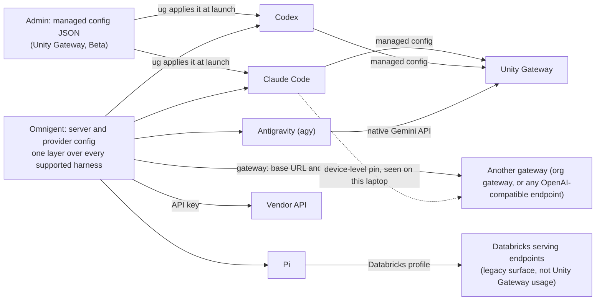

# N5: Configure once, any gateway

Draft, 2026-11-03. Covers slide N5 only. Claims are cited by primary source (Databricks docs, Omnigent docs and Omnigent source on GitHub) or by repo evidence. Quotes marked *(paraphrase)* come from WebFetch summaries and need a word-for-word check before they go on a slide, as `docs/research/facts.md` requires.

Verification legend: **verified** = primary source or recorded probe. **verified (paraphrase)** = primary page read through a summary; check the wording. **UNVERIFIED** = do not put on a slide. **[GAP: …]** = open.

This section does not repeat N2 (the agy cutaway) or N3 (routing). N5 is about where agent config comes from, and which gateway each agent talks to.

## Placement and timing

- **Slot:** after slide 16 (OSS vs managed), before slide 17 (OSS picture). Slide 17 gets folded into 16 (see Timing). Final order in the Databricks block: 16, **N5**, 18, N4.
- **Why here, against `outline.md`:**
  - Slide 16 is the one place the deck says where Omnigent runs and which parts are managed. N5 answers the next question: where does each agent's model and gateway config come from, and who can change it. Managed means an admin publishes one config. It doesn't mean every call is locked to one gateway.
  - Slide 16's line, "Start managed, drop to OSS when you need custom control", needs N5 to make "custom control" concrete. The Databricks admin config is the managed input. Omnigent provider config is the custom one.
  - N5 sits before N4 (audit), so the flow is config, then gateway, then audit trail. N4's "Request-level governance under Omnigent's run-level control" line then has the config in front of it.
  - **Rejected: right after N2 (Compose).** It would put the "any gateway" point straight after a Gemini cutaway, and the audience could take it as a change of subject. It would also split slides 11, N2 and 12, the Compose run, and separate "Team in one YAML" (slide 12) from the config idea it extends.
  - **Alternative: after slide 12 ("Team in one YAML").** Config-as-code pairs well with that slide. Use it only if the Compose act stays on schedule and the Databricks block can absorb N5 elsewhere. See Open threads.
- **Timing:** 0:45 on stage, a still. No cutaway, so no terminal switch.
- **Budget:** the outline's total is 19:00, with a 1:00 buffer. N5 at 0:45 leaves 0:15. Slide 17 is 0:15, and its point is covered by slide 16 and N5, so **fold 17 into 16 (−0:15)**. The total becomes 19:30 with a 0:30 buffer. If the optional N1 git beat (+0:20) is used, the total is 19:50, so the fold is needed in both cases. If Chris wants 17 kept, N5 plus git is 20:05. Don't run that.
- **What N5 replaces:** slide 17 (0:15). Nothing else moves.

## N5 slide

**Title:** Configure once, any gateway

*Alternative:* "Configure once, pick the gateway". Use it if the presenter doesn't want to promise "any" on stage (see the agy limit in Gaps). I'd lean toward the alternative.

**On-slide text (25 words):**

> Managed config (Beta): one JSON, applied by ug, for Claude Code and Codex. Omnigent: one layer over every supported harness, with providers for your gateways.

Word count: 25. Both "Beta" and "every supported harness" avoid the count question. Slide 11 says "13+" and facts say 18, so using a count here would add a third number. [GAP: pick one harness count for the deck. See Facts to add, row 16.]

**Visual (mermaid):**



Designer notes:
- The top box is the Databricks managed config, shown as an input for Claude Code and Codex only, because the schema's enum has two values. That is the honest picture. Don't draw it feeding Antigravity or Pi.
- The dotted edge is the device-level pin from the repo (see Gaps, and `docs/omni-fevm.md` "Round 3"). It's the "org gateway" case. Keep it dotted, labelled as observed on one laptop.
- "Vendor API" and "OpenAI-compatible endpoint" are both documented credential types (API key, gateway). Neither is demonstrated in this repo. Keep the label small, or drop the Vendor node if the slide is crowded.

**Speaker notes**

*Spoken script (about 45 s, roughly 110 words):*

> The config is the part you keep. The gateway is a setting.
>
> Databricks lets an admin publish one coding-agent config per workspace: which models Claude Code and Codex get, the defaults, and the MCP servers and skills. `ug` applies it when a developer launches an agent. Access runs through Unity Catalog grants. It's Beta, and it needs a preview. The schema covers two agents, Claude Code and Codex. Antigravity isn't in it at all.
>
> Omnigent is the layer above. It has four credential types: an API key, a subscription, a gateway with a base URL and a key, and a Databricks profile. An agent file picks the harness and the auth. Unity Gateway is a strong default. It isn't the only door.
>
> Not every gateway suits every harness. Antigravity needs one that speaks the native Gemini API.

*Reference, not spoken:*

- **Key line:** "The config is the part you keep. The gateway is a setting."
- **What the Databricks schema gives you (central, governed, distributed):**
  - One published JSON per workspace: `enabled_agents`, a `default_agent`, per-agent model sources and `default_models`, `smart_routing` and `tracing` toggles, `mcp_servers` and `skills` by Unity Catalog name. Verified (paraphrase), `coding-agent-config-schema`.
  - Governed: publishing needs a workspace admin. Developers need the Workspace access or Consumer access entitlement. With `unity_catalog_location`, each model service is available only where the developer has `EXECUTE`. Verified (paraphrase), `coding-agent-configure-govern`.
  - Distributed: agent and model settings sync when a developer launches through `ug`. MCP servers and skills sync on `ug configure`. "Changes can take a few minutes to appear." Verified (paraphrase), `coding-agent-configure-govern`. This closes the sync claim that appendix A4 left unsourced.
- **Honest limits (say these):**
  - Beta. "Coding agent configuration is in Beta." A workspace admin must enable the Unity Gateway Managed Configuration preview. Verified (paraphrase), `coding-agent-configure-govern`.
  - The agent enum has two values: `CODING_AGENT_CLAUDE_CODE` and `CODING_AGENT_CODEX`. Gemini CLI and Antigravity are not in the enum. `ug` does launch Gemini CLI (`ug gemini`), so say "the schema covers two agents", not "ug only covers two". Verified, AWS and GCP schema pages, plus `ug` quickstart.
  - One published config per workspace. Verified (paraphrase), `coding-agent-configure-govern`.
  - No base-URL field. Every model source is a Unity Catalog object: `model_services`, `model_provider_service`, or `unity_catalog_location`. The managed config can't name an arbitrary gateway URL. Verified from the schema field list. Non-Databricks providers in `ug` are a separate question (Gaps).
- **What Omnigent adds (one layer, providers per family, not Databricks-only):**
  - One layer over every supported harness. The supported page doesn't state a total. Counting its entries gives 18, which is ours, not the page's. Verified (paraphrase), `harnesses/supported`.
  - Four credential types: API key, Subscription, Gateway (base URL and key), Databricks (profile, routed through the Foundation Model API). Verified (paraphrase), `build/models`.
  - Providers are scoped by family, with `default: true` or `default: [anthropic, openai]`. Verified (paraphrase), `harnesses/configuration`.
  - Omnigent's own docs use OpenRouter as a gateway example. Claude Code uses `https://openrouter.ai/api` and Codex uses `https://openrouter.ai/api/v1`. Verified (paraphrase), `build/models`. Good proof that the gateway path isn't Databricks-only.
  - Agent YAML picks the harness and the auth: `executor.auth` can be `databricks` (with a profile), `api_key`, or `provider` (with a name). Verified (paraphrase), `AGENT_YAML_SPEC.md`.
- **Databricks "why it matters" (the honest version):**
  - Unity Gateway is a strong default. On the FEVM demo workspace, one identity served Anthropic, OpenAI-chat, OpenAI-Responses and native Gemini calls, and all four returned 200. `docs/setup-log.md` §6 (verified, probe).
  - It isn't lock-in. But governance goes where the gateway goes. A call that goes to the org gateway doesn't get a row in the Unity Gateway usage table. On this laptop, Claude Code and Codex stayed on the org gateway, and their calls never landed in FEVM usage. `docs/omni-fevm.md`, "Final matrix" (observed; cause unconfirmed).
  - Line for the room: "If the traffic goes somewhere else, Omnigent still runs the session. The usage table shows only what went through the gateway." Ties to N4.
- **DHH (notes only, ✅):** "Agents love the Unix philosophy." (01:40:37). Riff: "Small harnesses, and one config layer above them. That's the Unix idea one layer up." Slide 7 already uses this line; keep it out of N5's slide text.
- **Don't say:**
  - "Any gateway works with any harness." Agy rejects OpenAI-compatible routes (see below). Nothing in the repo runs Omnigent against a non-Databricks gateway end to end.
  - "Gemini CLI can't be configured." The managed schema can't configure it. `ug gemini` still launches it.
  - "Every call goes through Unity Gateway." That's slide 17's line, and it conflicts with this slide. See Edits.

## Demo beat: still, optional

No cutaway. A still keeps N5 to its 45 s slot and avoids a terminal switch. N2 already used the one terminal switch before the demo.

**Left panel: the `ug` config (Databricks side)**

- **Source:** `config/ug/coding-agent-config.json`, lines 1–9 (from the opening brace to the first `system.ai.claude-sonnet-5-5` entry). Verified by `jq` that the two `enabled_agents[].agent` values are `CODING_AGENT_CLAUDE_CODE` and `CODING_AGENT_CODEX`.
- **Expected content:** `"default_agent": "CODING_AGENT_CLAUDE_CODE"`, then `"model_services"` with `"system.ai.claude-sonnet-5-5"` first. Crop above the `mcp_servers` placeholder (`omnigent_talk.demo.<mcp-server>`), which is a placeholder and shouldn't show.
- **Redaction:** none needed beyond the crop. No host, no profile.

**Right panel: an Omnigent provider (Omnigent side)**

- **Source:** `docs/setup-log.md` §4 (the provider block after `omni-fevm setup`). Verified as a provider block, from the presenter's own setup echo.
- **Expected content, redacted:**
  ```yaml
  providers:
    <provider-name>:
      kind: databricks
      profile: <profile>
      native_gemini: true
      default: true
  ```
- **Redaction:** the provider name in `setup-log.md` starts with `databricks-gemini-`. That label is in D7 (see `gaps.md`), so the name is replaced with `<provider-name>`. The profile is `<profile>`, not the real name.
- **Status:** `kind: databricks` is repo-observed and **UNVERIFIED in the public Omnigent docs** (see Facts to add, row 10). The docs use Databricks as a credential type but don't show this YAML.
- **[GAP: no provider example for a non-Databricks gateway, in the repo or in the docs I read. Don't draw one. The right panel stays Databricks-only, and the slide says so.]**

**Fallback**

- The slide and diagram carry the message on their own. If the still doesn't render, show the slide without panels and narrate the two bullets.
- [GAP: no screenshot or redacted capture of either file exists under `talk/fallbacks/`. Make one from the exact sources above before the dry run.]

**Screen hygiene check (before the still goes in the deck)**

- No workspace host, no `~/.omnigent*` path, no profile name, no provider name starting `databricks-gemini-`, no `.env.local` value.
- The `ug` crop shows no `mcp_servers` placeholder and no `x-demo` header.

**Rehearsal status:** not rehearsed. The still is captured from files, not run. [GAP: a dry run of the still needs a timer, log in `lessons.md`, which doesn't exist yet.]

## How to do this with Omnigent (mini-guide)

Read-only commands from the docs. Nothing was run. Status labels are on each step.

1. **Connect Omnigent to a workspace, or set up a self-hosted server.** Databricks-managed: `omni login <workspace-url>` (**verified (paraphrase)**, the Databricks quickstart, `https://docs.databricks.com/aws/en/omnigent/quickstart`, as recorded in `facts.md` "Omnigent on Databricks quickstart"). Self-hosted: `omni setup` asks for a base URL and a key (**verified (paraphrase)**, `build/models`).
2. **Add a provider for each gateway.** The gateway credential type is a base URL plus a key, entered through `omni setup` (**verified (paraphrase)**, `build/models`). In `~/.omnigent/config.yaml` providers live under `providers:`, with a `kind` and a family block (for example `openai:`) that holds `base_url`, `api_key`, and `models` (**shape verified (paraphrase)**, `harnesses/configuration`; the exact nesting is **UNVERIFIED** until you read `omni config list` on a real config). The Databricks entry (`kind: databricks`, `profile: <profile>`) is **UNVERIFIED in the public docs**; it appears only in repo config (`docs/setup-log.md` §4).
3. **Set one default per family.** `default: true` on one provider per family, or `default: [anthropic, openai]` to scope it (**verified (paraphrase)**, `harnesses/configuration`).
4. **Pin each agent's harness and auth in its YAML.** `executor: {harness: claude-sdk, model: <model>, auth: {type: databricks, profile: <profile>}}` (**verified**, `AGENT_YAML_SPEC.md` and `build/models`). Own-auth harnesses (Claude, Codex, and others) take their auth from their own CLI config, and Omnigent stores no credential for them (**verified (paraphrase)**, `harnesses/configuration`). That's why a device-level pin can override Omnigent's intent. The repo shows this on one laptop (**observed**, `docs/omni-fevm.md`).
5. **Run it, then check where it landed.** `omni run agent.yaml --model <model>` (**verified (paraphrase)**, `build/models`). For Unity Gateway, check `system.ai_gateway.usage` (**verified**, repo query and facts row). For any other gateway, check that gateway's logs. [GAP: no documented way to see a non-Databricks gateway's calls from Omnigent.]

**Team distribution (the question you asked).** [GAP: I found no documented way to push Omnigent provider config to a team.] Provider config is per user in `~/.omnigent/config.yaml`. The project file `.omnigent/config.yaml` can set the default harness and nothing else (**verified (paraphrase)**, `harnesses/configuration`). The agent YAML is the thing a team can share, and it has no `extends` or include mechanism (**verified (paraphrase)**, `AGENT_YAML_SPEC.md`). The only documented team-wide config is the Databricks managed `ug` config, which covers Claude Code and Codex only.

**Databricks side, for context (`ug`, verified):** `uv tool install git+https://github.com/databricks/unity-gateway`, then `ug --version`, then `ug configure`, then `ug claude` or `ug codex` (**verified (paraphrase)**, `coding-agent-quickstart`). Admin publish: `databricks api post /api/ai-gateway/v2/coding-agent-configs --json @<config.json>` (**verified (paraphrase)**, `coding-agent-configure-govern`). The repo's `config/ug/README.md` has the same command with the profile filled in. Don't put the profile on screen.

## Edits for the integrator (not made here)

Only `talk/sections/04-agent-config.md` was changed. These are for the integrator to apply.

1. **`talk/outline.md`:** add a row after 16:
   `| N5 | **Configure once, any gateway** | Databricks | 0:45 | **new** | sections/04-agent-config.md. Still, no cutaway. Replaces slide 17 (folded into 16) |`
   Update the total to 19:30 and the buffer to 0:30. Note the git-beat conflict: with the N1 git beat, the total is 19:50.
2. **`talk/outline.md`, slide 17 row:** mark it "**cut** (folded into 16)". Slide 17's text, "Every LLM and MCP call goes through Unity Gateway", conflicts with N5 (multi-gateway). Either drop that line or rewrite it as "by default, through Unity Gateway". Ask Chris which.
3. **`talk/speaker-notes.md`:** add an N5 block between 16 and 18, with the spoken script above and a pointer to this section for the rest.
4. **`talk/summary.md`, arc step 6 (Databricks):** add "N5: config is published once for Claude Code and Codex, and Omnigent points each harness at the gateway it should use."
5. **`talk/summary.md`, "Where this repo's work lands" table:** add a row. "`config/ug/coding-agent-config.json` and Omnigent provider config | N5 | Beta; schema verified; Omnigent multi-gateway documented, not demonstrated."
6. **`talk/appendix.md`, A4:** three changes. (a) The sync claim is now sourced: mark unsourced claim 3 verified (paraphrase). (b) The entitlement claim is now sourced: mark unsourced claim 2 verified (paraphrase). (c) "Gemini CLI can't be set here" is true for the schema, but `ug gemini` exists. Reword the notes to say that. Claim 6 (Claude Code needs Messages, Codex needs Responses) stays unsourced.
7. **`talk/gaps.md`:** add three entries.
   - Presenter decision: placement after 16 (recommended) vs after 12.
   - Must close before rehearsal: "any gateway" is documented, not demonstrated. Either run one non-Databricks gateway through Omnigent (needs Chris's approval; it touches a live setup), or soften the claim to "Omnigent's docs list a gateway credential type".
   - Deck wording: slide 11's "13+" and this slide's count must match, and `facts.md` row "Harness tiers and modes" needs a fix (row 16 below).
8. **`docs/research/facts.md`:** add the rows below and correct two existing rows (rows 15 and 16). Don't edit it here.

## Facts to add

Rows in `docs/research/facts.md` format. Where a row corrects an existing row, the note says so.

| Claim | Quote / detail | URL | Status |
| :--- | :--- | :--- | :--- |
| 1. Coding-agent config schema (**extends** existing row) | Agent enum: `CODING_AGENT_CLAUDE_CODE`, `CODING_AGENT_CODEX` only. Top level: `default_agent`, `enabled_agents`, `mcp_servers`, `skills`, `smart_defaults`. Per agent: `models` (one of `model_services`, `model_provider_service`, `unity_catalog_location`), `default_models` (`default_model`; Claude adds `default_opus_model`, `default_sonnet_model`, `default_haiku_model`, `default_fable_model`), `smart_routing.enabled`, `tracing.enabled`, `http_headers`, `agent_native_settings` (Claude Code only). `mcp_servers` and `skills` take `names` or `unity_catalog_location`. The existing row omits `agent_native_settings`, `unity_catalog_location`, `model_provider_service`, `default_fable_model`, and the `names` form | https://docs.databricks.com/aws/en/ai-gateway/coding-agent-config-schema | verified (paraphrase), 2026-11-03. The GCP schema page (https://docs.databricks.com/gcp/en/ai-gateway/coding-agent-config-schema) gives the same enum and fields in summary. |
| 2. Managed config is Beta; preview required | "Coding agent configuration is in Beta." A workspace admin must enable the Unity Gateway Managed Configuration preview from the Previews page | https://docs.databricks.com/aws/en/ai-gateway/coding-agent-configure-govern | verified (paraphrase). Word-for-word check OPEN |
| 3. Config sync timing | "When developers launch an agent through `ug`, it checks the published configuration and applies updated agent and model settings." "Changes can take a few minutes to appear." "To refresh immediately and sync managed MCP servers and skills, run: `ug configure`" | https://docs.databricks.com/aws/en/ai-gateway/coding-agent-configure-govern | verified (paraphrase). Closes appendix A4 claim 3 |
| 4. Config entitlements and grants | Publishing requires a workspace admin. Developers need the Workspace access or Consumer access entitlement. For `unity_catalog_location`, each model service is available only with `EXECUTE` | https://docs.databricks.com/aws/en/ai-gateway/coding-agent-configure-govern | verified (paraphrase). Closes appendix A4 claim 2 |
| 5. `ug` supported agents (AWS page) | Claude Code (`ug claude`), Codex (`ug codex`), Cursor (`ug mcp add --agents cursor`, MCP only), Cursor Agent (`ug cursor`, MCP only), GitHub Copilot CLI (`ug copilot`), Gemini CLI (`ug gemini`), OpenCode (`ug opencode`), Pi (`ug pi`). Antigravity and Omnigent not mentioned. "Support varies by agent and version." | https://docs.databricks.com/aws/en/ai-gateway/coding-agent-supported-agents | verified (paraphrase) |
| 6. `ug` external-provider column, both pages | Claude Code: Yes. Codex: Yes. Gemini CLI: Yes (Gemini Enterprise). Cursor: AWS summary says external providers "not" supported; GCP summary says "Not documented" | AWS and GCP `coding-agent-supported-agents` | verified (paraphrase) for Claude Code, Codex and Gemini CLI. Cursor wording **differs between the two summaries**: UNVERIFIED until read on the page |
| 7. `ug` launch commands (quickstart) | `ug claude`, `ug codex`, `ug gemini`, `ug opencode`, `ug copilot`, `ug pi`. Install: `uv tool install git+https://github.com/databricks/unity-gateway`, then `ug --version`. `ug configure` configures Claude and Codex "if it's installed" | https://docs.databricks.com/aws/en/ai-gateway/coding-agent-quickstart | verified (paraphrase). Quickstart lists six commands; supported-agents also lists Cursor |
| 8. Managed config has no base-URL field | Field list has no URL key. Model sources are Unity Catalog objects only | schema page (row 1) | verified from the field list. Whether a non-Databricks provider can be used through `ug` is **UNVERIFIED** (Gaps 4) |
| 9. Omnigent credential types | Four types: "API key" (first-party key), "Subscription" (Claude Pro/Max or ChatGPT Plus/Pro), "Gateway" (proxy or local model, base URL and key), "Databricks" (workspace profile, routed through the Foundation Model API) | https://omnigent.ai/docs/build/models | verified (paraphrase) |
| 10. Omnigent provider `kind` values | Docs show `kind: gateway` and `kind: local`. `kind: databricks` and `kind: subscription` appear only in repo config (`docs/omni-fevm.md`, `docs/setup-log.md` §4). `kind: key` not found in any page read | https://omnigent.ai/docs/build/harnesses/configuration (kinds); repo for the rest | `gateway` and `local`: verified (paraphrase). `databricks`: **UNVERIFIED** in public docs. `key`: **UNVERIFIED**, not found. No existing facts row covers `kind`; this one is new |
| 11. Provider defaults are per family | `default: true` sets the default for the families a provider lists. `default: [anthropic, openai]` scopes it. A `gemini:` block doesn't activate with `default: true` for native agy | https://omnigent.ai/docs/build/harnesses/configuration | verified (paraphrase) |
| 12. Agent YAML auth | `executor.auth.type`: `databricks` (with `profile`), `api_key` (with `api_key`, optional `base_url`), `provider` (with `name`). No `extends` or include | https://raw.githubusercontent.com/omnigent-ai/omnigent/main/docs/AGENT_YAML_SPEC.md | verified (paraphrase) |
| 13. Own-auth harnesses | Claude, Codex, ACP agents, Devin, Kimi, OpenCode, Hermes, Grok Build, Jcode "bring their own auth. Omnigent stores no credential for them" | https://omnigent.ai/docs/build/harnesses/configuration | verified (paraphrase) |
| 14. Native agy gateway requirements | Must serve Gemini `generateContent` and `streamGenerateContent`, use `x-goog-api-key`. OpenAI Responses and Chat Completions routes are not accepted, including for Gemini models | https://raw.githubusercontent.com/omnigent-ai/omnigent/main/docs/native-agy-gateways.md and `build/models` | verified (paraphrase). Matches `facts.md` "Native agy creds" row |
| 15. Routing config (**correction** to existing row) | `llm:` block fields: `model` (required), `connection` (optional overrides such as `api_key`, `base_url`), `profile` (optional), `fallback_models` (optional). `request_timeout` is a **server-level** setting, not a block field. `routing: {provider: external, base_url, router_name, model_prefix, api_key | profile}`; the server appends `/routes:select` | https://omnigent.ai/docs/reference/configuration/routing | verified (paraphrase). The existing row lists `request_timeout` as a block field: correct it |
| 16. Harness count and tiers (**correction** to existing row) | The supported page states no total. Counted entries: 18 (15 in the main table, 3 in the ACP section). Labelled tiers: fully supported (3), maintained (4), community-supported (8). The ACP section (Goose, Grok Build, Jcode) has no tier. The existing row's "18 harnesses in 3 tiers" should read "18 counted; three labelled tiers plus an unlabelled ACP section" | https://omnigent.ai/docs/build/harnesses/supported | count and tiers verified (paraphrase); the total of 18 is ours |
| 17. Gateway examples in Omnigent docs | OpenRouter with Claude Code: base URL `https://openrouter.ai/api`. Codex and OpenAI-agent harnesses: `https://openrouter.ai/api/v1`. Claude Code must not use the `/api/v1` path | https://omnigent.ai/docs/build/models | verified (paraphrase). Use for "not Databricks-only" |
| 18. Usage on Unity Gateway vs other gateways | Unity Gateway calls land in `system.ai_gateway.usage`. Calls through the legacy `/serving-endpoints` surface land in `system.serving.endpoint_usage`. Calls that go to another gateway land in neither | repo: `docs/omni-fevm.md` ("Two usage tables"; "Final matrix") | observed on FEVM, 2026-11-03. "Calls to another gateway land in neither" is an inference from the matrix, **UNVERIFIED** as a general rule |

## Gaps

- [GAP: Omnigent public docs don't show `kind: databricks` or `kind: key`. The Databricks provider shape comes from repo config only. See Facts row 10.]
- [GAP: no documented way to push Omnigent provider config to a team. The agent YAML is shareable, but its only reuse mechanism is `instructions:` files and sub-agents. Ask whether Omnigent has a server-side template for this, and check `docs/deploy/overview` and `docs/collaborate/auth`, which I didn't read.]
- [GAP: one config, different gateways per harness. Provider scoping is by family (anthropic, openai, gemini, pi), and per-harness auth is in agent YAML. The docs don't say a single config maps named harnesses to named gateways. Say "per family and per agent" if asked.]
- [GAP: the managed `ug` config to a non-Databricks gateway. The schema has no URL field, and the `ug` table says external providers are "Yes" for Claude Code, Codex and Gemini CLI. How that's configured isn't in the schema page. Possibly a Databricks external model provider service, but **UNVERIFIED**.]
- [GAP: which config wins for Claude Code and Codex inside Omnigent. Omnigent doesn't store a credential for them, and org-managed settings pinned the gateway on this laptop. Does `ug configure`'s managed settings (`agent_native_settings`, written to the machine-wide Claude Code settings file) affect Omnigent-run Claude sessions? Unknown. Test with usage rows, not logs, as `docs/setup-log.md` §9 says.]
- [GAP: "any gateway" is documented, not demonstrated. Nothing in the repo runs Omnigent against a non-Databricks gateway end to end. The only non-Unity gateway in the repo is the org gateway, reached through device settings, not Omnigent config. Either run one (needs approval), or keep the claim to "the docs list a gateway credential type".]
- [GAP: agy with an OpenAI-compatible gateway. Documented as unsupported. So a gateway "for any harness" isn't true. This is the honest limit, and it's on the slide notes, not the slide.]
- [GAP: slide 17's "every LLM and MCP call goes through Unity Gateway" conflicts with N5. Chris to decide the wording.]
- [GAP: no captured still for either panel. Build from the exact sources listed in the demo beat.]
- [GAP: GCP vs AWS. The schema pages match in summary. The supported-agents pages differ on Cursor's external-provider wording. Read both word-for-word before the deck freeze.]
- [GAP: a timed dry run of the still. No `lessons.md` in the repo yet.]
- [GAP: the Opus and Haiku entries in the draft config. A4 says neither is verified as served. N5 doesn't use them. Don't show them.]

## Open threads

- **Placement:** after 16 (recommended, above) or after 12 ("Team in one YAML"). Chris to decide. The recommendation depends on the Compose act's timing.
- **Title:** "Configure once, any gateway" or "Configure once, pick the gateway". The second is what the notes can fully support.
- **Demo still:** keep the two panels, or drop the right one and show only the diagram. The right panel is Databricks-only and makes the "any gateway" point harder to back. Dropping it is the safer choice.
- **Run one non-Databricks gateway through Omnigent?** It would turn the "any gateway" claim from documented to demonstrated. It touches a live config, so it needs Chris's approval first. Not run here.
- **Slide 17 wording and the 17-into-16 fold:** both need a decision before the outline is updated.
- **Git beat:** with N5 in, the git beat fits only if 17 is folded. Chris to confirm.
- **Read the GCP and AWS summaries word-for-word:** all WebFetch quotes in this file are paraphrase until checked.
